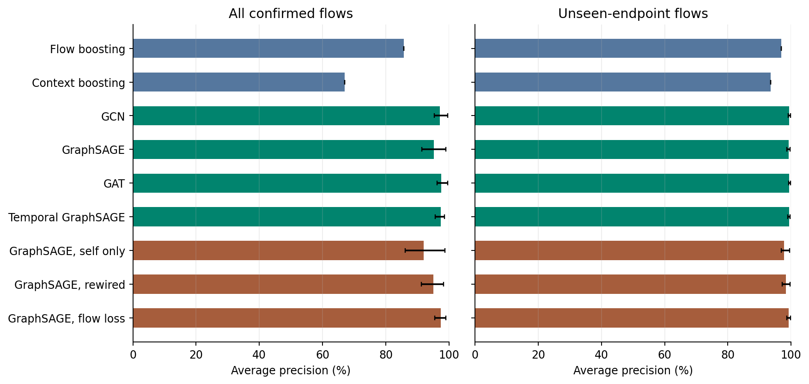
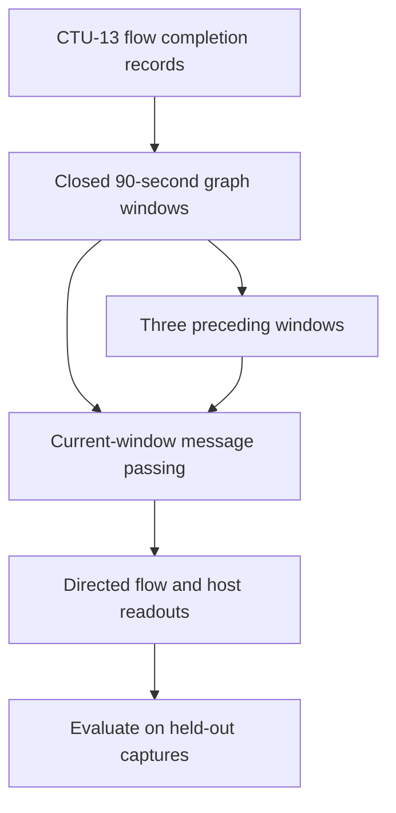
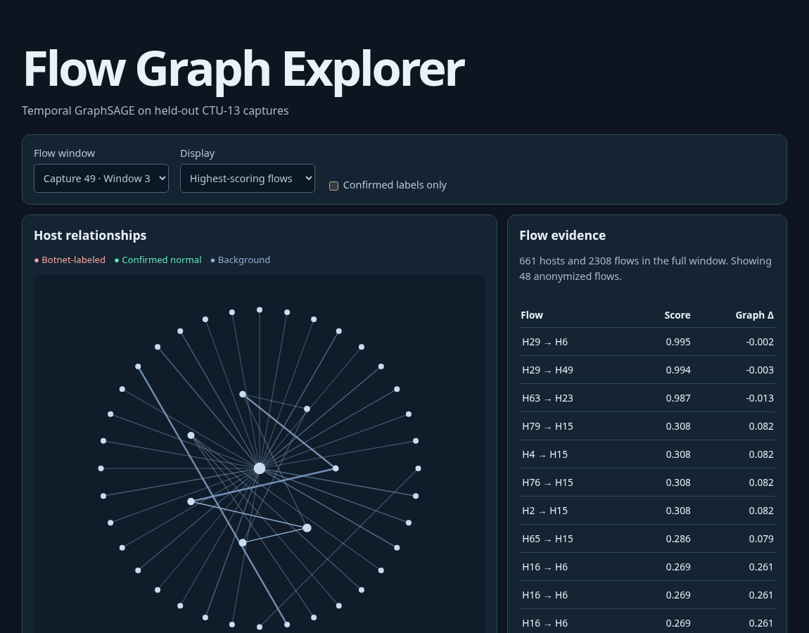

# Graph Neural Networks for Flow Detection

A capture-disjoint study of whether graph context helps classify botnet-labeled network flows. It compares four neural graph variants with gradient boosting and tests how much of the gain depends on the actual adjacency.

## Results

On three held-out CTU-13 captures, GAT achieved **97.58% flow average precision**, versus **85.66%** for flow-only gradient boosting. At a threshold set on confirmed-normal validation traffic, the observed recall and false-positive rate were **97.36%** and **3.01%**. These rates use 341 botnet and 1,940 confirmed-normal test flows. Unverified background traffic contributes graph context.

| Model | Flow AP | Recall | FPR | Host-incidence AP | Unseen-endpoint AP |
|---|---:|---:|---:|---:|---:|
| Flow boosting | 85.66% | 81.52% | 5.21% | 86.30% | 96.85% |
| Context boosting | 67.05% | 33.14% | 2.78% | 69.91% | 93.53% |
| GCN | 97.10% | 93.26% | 4.59% | 94.32% | 99.40% |
| GraphSAGE | 95.21% | 91.40% | 4.67% | 95.29% | 99.28% |
| GAT | 97.58% | 97.36% | 3.01% | 95.01% | 99.44% |
| Temporal GraphSAGE | 97.43% | 97.36% | 4.36% | 94.21% | 99.31% |

GraphSAGE achieved 91.93% AP with self-only messages and 95.11% with rewired adjacency. True adjacency gave 95.21%. On this split, message passing helped relative to the self-only control. The specific network links accounted for little of the aggregate difference between the two message-passing arms.

The unseen-endpoint slice contains 337 confirmed flows, of which 265 are positive. Its higher positive prevalence raises the AP baseline. Only 64 confirmed flows fall in windows with 57 or fewer flows, so the small-window estimate has limited support.



## Method



1. Sample four disjoint byte ranges from each of 13 captures. The manifest pins 52 segments by SHA-256.
2. Build 1,354 bounded observation windows from 433,377 flow rows. Use addresses for adjacency and novelty slices. Train on numeric flow and node features.
3. Compare nine model and ablation variants across three seeds. Measure known-label results, unseen-endpoint behavior, graph-size slices, inference time and per-capture variability.

## Reproduce and explore

```sh
python -m venv .venv
source .venv/bin/activate
python -m pip install torch==2.15.0 --index-url https://download.pytorch.org/whl/cpu
python -m pip install -e '.[report]'
OPENBLAS_NUM_THREADS=1 OMP_NUM_THREADS=1 python -m unittest discover -s tests -v
python -m graphids.acquire
OPENBLAS_NUM_THREADS=1 OMP_NUM_THREADS=1 python -m graphids.study
gzip -nc results/study.json > results/study.json.gz
python scripts/report.py
python -m graphids.dashboard
```

Generate the inspector directly from checked-in results with `python -m graphids.dashboard`, then open `results/flow-graph.html`. Select a window, choose a node or flow, and inspect the score change when the trained model receives only self messages.



[Technical report](results/graph-flow-detection-report.pdf) · [Methodology and citations](docs/METHODOLOGY.md) · [Interview questions and résumé drafts](docs/INTERVIEW.md)

## Limits

CTU-13 is older single-site data. The benchmark uses partial captures and three fixed test recordings. Host labels describe incidence to confirmed botnet flows. They give limited evidence about individual device compromise. The dataset does not annotate attack-sequence stages, so temporal context is tested at the flow-window level. Code development was AI-assisted.
